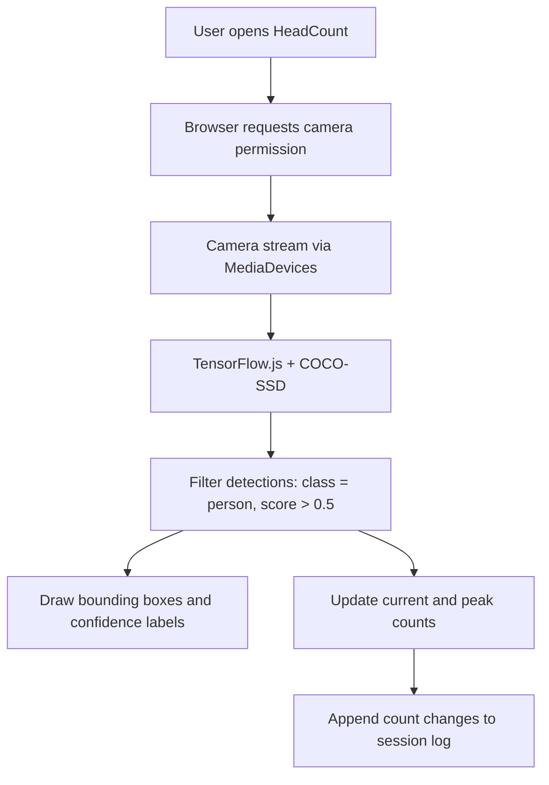

# HeadCount — Live People Counter

A browser-based people-counting prototype that uses a webcam stream and TensorFlow.js COCO-SSD object detection to count visible people in real time.

[](https://github.com/MokuLakshithReddy/people-counter-live/stargazers)
[](https://github.com/MokuLakshithReddy/people-counter-live/commits/main)
[](https://react.dev/)
[](https://www.tensorflow.org/js)
[](https://github.com/tensorflow/tfjs-models/tree/master/coco-ssd)

## Why it matters

Manual headcounts are slow and difficult to repeat in busy spaces. HeadCount demonstrates a lightweight, camera-based workflow that detects people, updates a live count, and keeps a short session history.

## How it works



## Current features

- Browser camera capture through the MediaDevices API (640 × 480 requested).
- In-browser COCO-SSD model loading via TensorFlow.js.
- Person-only detections with a confidence threshold greater than 0.5.
- Canvas overlay with bounding boxes and confidence labels.
- Live count, session peak, and a rolling list of up to 100 count-change log entries.
- Light/dark theme toggle and responsive dashboard layout.

## Technology

React 18 · TypeScript · Vite · TensorFlow.js · COCO-SSD · Tailwind CSS · shadcn/ui

## Run locally

Requirements: Node.js and npm, plus a modern browser with camera access.

```bash
npm install
npm run dev
```

Open the Vite development URL and allow camera access when prompted. Camera permission is required for detection.

## Build and tests

```bash
npm run build
npm test
npm run lint
```

## Privacy and limitations

- The current implementation obtains a camera stream in the browser and runs the model in the client. Do not deploy it in spaces where people have not been informed and given appropriate notice.
- The repository code shown here does not persist video or create identity profiles; the log stores timestamps and counts in the current UI session.
- Counts are model detections, not a calibrated occupancy measurement. Occlusion, camera angle, lighting, crowd density, and device performance can affect results.
- No labelled evaluation dataset, precision/recall benchmark, or count-accuracy study is currently published.

## Repository

[Browse the source](https://github.com/MokuLakshithReddy/people-counter-live)
