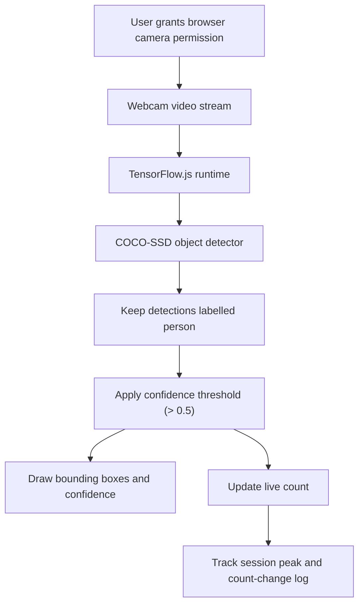

# HeadCount — Live People Counter

A browser-based people-counting prototype that uses a webcam stream and TensorFlow.js COCO-SSD object detection to count visible people in real time.


## Why it matters

Manual headcounts are slow and difficult to repeat in busy spaces. HeadCount demonstrates a lightweight, camera-based workflow that detects people, updates a live count, and keeps a short session history.

## How it works



## Current capabilities

- Starts a webcam stream using the browser's `getUserMedia` API.
- Loads COCO-SSD through TensorFlow.js in the browser.
- Counts detections classified as `person` when the model score is above `0.5`.
- Draws detection bounding boxes and confidence labels over the video.
- Shows the current count, session peak, and a time-stamped log of count changes.
- Includes a dark-mode toggle and responsive layout.

## Privacy and limitations

- Camera access requires explicit browser permission.
- The current detector runs in the client; the inspected detection flow does not upload or persist video.
- This is a single-camera prototype, not a calibrated occupancy or access-control system.
- Detection quality and frame rate depend on lighting, camera angle, occlusion, and the device running the model.
- The confidence threshold is a code setting, not a guarantee of counting accuracy.

## Technology

React 18 · TypeScript · Vite · TensorFlow.js · COCO-SSD · Tailwind CSS · shadcn/ui

## Run locally

```bash
npm install
npm run dev
```

Allow camera access when the browser prompts you.

## Build and tests

```bash
npm run build
npm test
npm run lint
```

These commands are defined in `package.json`; no public accuracy, latency, or multi-camera benchmark is currently published.

## Repository

[Browse the source](https://github.com/MokuLakshithReddy/people-counter-live)
